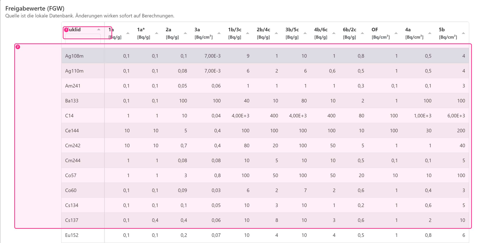

# Freigabewerte (FGW)

Freigabewerte (FGW) sind die nuklidspezifischen Grenzwerte, gegen die FMB Log gemessene Aktivitäten prüft. Sie sind zentral für die Berechnung von Freigabewerten eines Nuklidvektors und für die Freigabeprüfung in Vorschau und PDF der Gebindeabrechnung.

FGW liegen als versionierte Stammdaten im zentralen PostgreSQL-Bestand und in der lokalen SQLite-Replik. Änderungen erzeugen eine signierte Operation, die der Dienst beim Abgleich prüft. Die Oberfläche bleibt auch mit dem bereits geladenen Offline-Bestand nutzbar.

## Zugriff und Berechtigung

Die Seite **Freigabewerte** ist nur sichtbar, wenn Sie Administrator sind oder die Permission `fgw.update` besitzen. So kann ein Key‑User FGW pflegen, ohne Voll‑Admin zu sein.

## Einheiten und Struktur

FGW werden pro Nuklid und Freigabepfad gespeichert. Die Einheit hängt vom Pfad ab:

- Oberflächenspezifische Pfade (z. B. OF/3a/4a/5b) in $Bq/cm^2$
- Alle übrigen Pfade in $Bq/g$

- (1) Filter (Nuklid)
- (2) FGW‑Tabelle

## Änderungen im Betrieb

Lokale Änderungen stehen zunächst unter dem Vorbehalt zentraler Übernahme. Prüfen Sie den Versionszustand und klären Sie Konflikte vor einer offiziellen Abrechnung. Abrechnungen binden die tatsächlich verwendeten Stammdatenversionen; ein bestehender signierter Beleg wird nicht nachträglich überschrieben.

::: info Zusammenfassung (FGW)
- Zugriff nur als Admin oder mit `fgw.update`.
- Einheiten: OF/3a/4a/5b in $Bq/cm^2$, sonst in $Bq/g$.
- Änderungen signieren, zentral abgleichen und den Versionszustand prüfen.
:::
