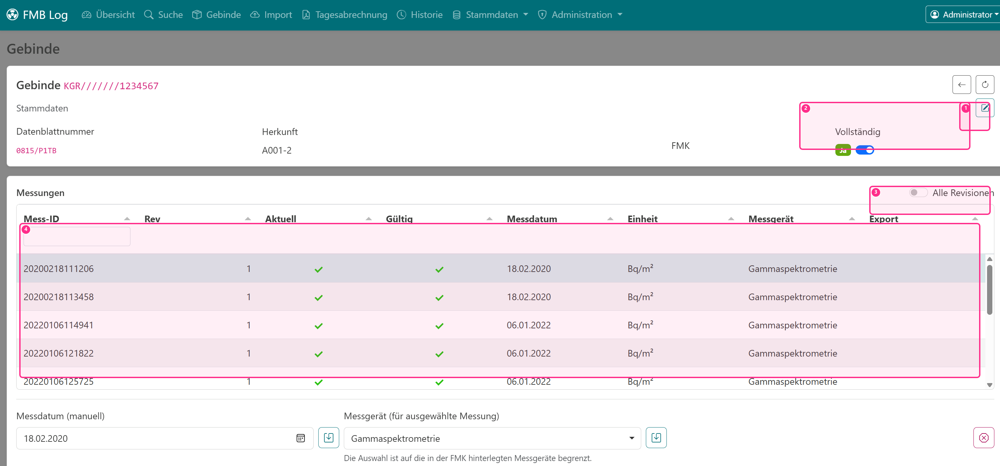
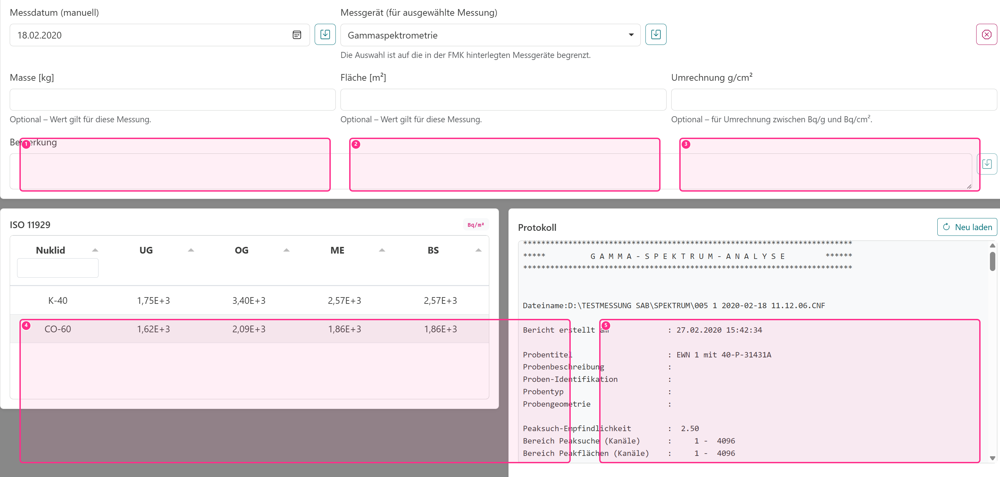

# Gebinde & Messungen

Ein **Messobjekt** fasst Gebinde einer FMK unter einer eindeutigen **MeObj-Nr.** zusammen. Jedes Gebinde enthält genau eine Stoffklasse; bei NEM01/NEM02 zusätzlich genau eine Metallart. Messungen (aus Protokollen) werden immer einem Gebinde zugeordnet, damit Sie später:

- alle Messungen eines Gebindes gesammelt sehen,
- deren Historie nachvollziehen können (Revisionen),
- und daraus Gebindeabrechnungen erzeugen.

## Messobjekte

Unter **Messobjekte** legen Sie Messobjekte mit MeObj-Nr. und FMK an. Die Übersicht zeigt Gebindeanzahl, gemeinsamen Freigabepfad und Freigabestatus. In den Details sehen Sie je Gebinde, welche Pfade bestanden, ausgeschlossen oder noch nicht bewertbar sind. **Gebinde hinzufügen** öffnet ein neues Gebinde mit vorgegebenem Messobjekt. Bestehende Gebinde können innerhalb derselben FMK einem anderen Messobjekt zugeordnet werden.

Im Gebindeformular wählen Sie zuerst das Messobjekt. Die FMK und ihre zulässigen Chargen, Stoffklassen und Freigabepfade werden daraus übernommen. Die FMK eines belegten Messobjekts kann nicht gewechselt werden; nur leere Messobjekte können gelöscht werden.

Ein gemeinsamer Pfad muss für **alle Gebinde und sämtliche gültigen Messungen** einschließlich Zusatzprüfungen bestehen. Rot bedeutet, dass kein gemeinsamer Pfad mehr möglich ist. Gelb bedeutet, dass Daten, Messungen oder der Abschluss von Gebinden fehlen. Lokale Änderungen werden als vorläufig gekennzeichnet. Einzelne ausgeschlossene Pfade verhindern die Freigabe nicht, wenn ein anderer gemeinsamer Pfad besteht.

### Messhilfe

Die aufklappbare **Messhilfe** im Gebinde zeigt je zulässigem Pfad die maximal zulässige **Bruttoimpulsrate in Ips** für MicroCont 2 sowie die NV-Freigabewerte einschließlich SW für MC2 und Gammaspektrometrie. Sie können Messdatum, Nulleffekt, Nulleffektmesszeit und Messzeit ändern. Vorgaben sind 5 Ips, 100 s und 10 s. Bei einer ausgewählten Messung hat deren manuell hinterlegtes Messdatum Vorrang.

Die Ips-Grenze berücksichtigt die obere Vertrauensgrenze, KF/SW und Zusatzprüfungen. Die verwendete Umrechnung wird angezeigt. Änderungen in der Messhilfe verändern keine gespeicherten Messungen. Ein nicht gemeinsam zulässiger Pfad bleibt entsprechend gekennzeichnet.

## Gebindeübersicht

Unter **Gebinde** finden Sie eine tabellarische Übersicht. Über die Filterzeile können Sie schnell nach Gebindenummer, Datenblatt oder FMK suchen. Ein Klick auf eine Zeile öffnet die Detailansicht.

Die Spalte **Messungen** zählt bewusst nur die **aktuellen Revisionen**. Das macht die Übersicht übersichtlich, auch wenn einzelne Messungen im Laufe der Zeit aktualisiert wurden.

- (1) Stammdaten bearbeiten (Stift-Symbol)
- (2) Arbeitsstatus „Vollständig“
- (3) Umschalten zwischen „aktuellen Revisionen“ und „Alle Revisionen“
- (4) Messungsliste (zeigt standardmäßig nur aktuelle Revisionen)

::: info In der Übersicht sehen Sie
- Gebindenummer, Datenblattnummer, Herkunft, FMK
- „Vollständig" als Arbeitsstatus (keine weiteren Messungen erwartet)
- Anzahl Messungen (nur aktuelle Revisionen)
:::

## Gebinde-Details

In der Detailansicht bearbeiten und prüfen Sie ein Gebinde. Typische Aufgaben sind:

- Stammdaten am Gebinde (Herkunft, Datenblatt, Messobjekt) ergänzen,
- Messdaten pro Messung (Masse/Fläche, Umrechnung, Bemerkung) ergänzen oder korrigieren,
- den Status **Vollständig** setzen oder zurücknehmen,
- Messungen auswählen und Protokolle/ISO-Werte prüfen,
- Messungen bei Bedarf als **ungültig** markieren (mit Begründung).

Die Messungsliste kann zwischen **aktuelle Revisionen** und **alle Revisionen** umgeschaltet werden. So bleibt die Arbeitsansicht übersichtlich, während die Historie jederzeit verfügbar ist.

### Stammdaten am Gebinde ändern

Der Bereich **Stammdaten** zeigt zunächst die gespeicherten Werte. Erst **Stammdaten bearbeiten** öffnet das Formular. Nach erfolgreichem Speichern erscheint wieder die gespeicherte Ansicht. **Bearbeitung abbrechen** verwirft Änderungen nach Bestätigung. Unverändertes Speichern erzeugt keine neue Version.

**Gebindemasse** und **Gebindeoberfläche** sind eigene Stammdaten. **Masse [kg] (Messungen)** und **Fläche [m²] (Messungen)** gehören dagegen zur einzelnen Messung. Bei der Berechnung der Gesamtaktivität gilt jeweils der kleinere Wert aus tatsächlicher Messmasse/-fläche und maximaler Bezugsgröße der FMK. Fehlt eine FMK-Grenze, gilt der Messwert. Gebindewerte ersetzen keine fehlenden Messwerte.

Dateiimporte und neue Importrevisionen erfolgen ausschließlich über **Import**.

::: warning Hinweis
Beim Import werden Stammdaten eines **bestehenden** Gebindes nicht geändert. Wenn Sie Korrekturen vornehmen müssen (z. B. falsche FMK oder Datenblattnummer), erledigen Sie das im Menü **Gebinde** in der Detailansicht.
:::

Für das Ändern dieser Werte ist die Berechtigung `measurements.update` erforderlich (oder Admin).

### Messungen auswählen und gemeinsam bearbeiten

Ein Klick auf eine Zeile oder ihr Kästchen wählt diese Messung und öffnet ihre
Details. Ein erneuter Klick auf die allein ausgewählte Messung hebt die Auswahl
auf; die zuletzt geöffneten Details bleiben sichtbar. **Strg/Cmd + Klick** ergänzt
oder entfernt einzelne Messungen. **Umschalt + Klick** wählt einen Bereich in der
aktuellen Sortierung und Filterung, **Strg/Cmd + Umschalt + Klick** ergänzt einen
Bereich. Das Kästchen im Tabellenkopf wählt die gefilterten Messungen oder hebt
deren Auswahl auf. Die Kästchen sind auch per Tabulator und Leertaste bedienbar.

Bei mehreren ausgewählten Messungen erscheint **Messungen gemeinsam bearbeiten**.
Messdatum, Gerät, Masse, Fläche, Umrechnung und Bemerkung stehen zunächst auf
**Nicht ändern**. Wählen Sie pro Feld ausdrücklich **Wert setzen**, **Wert löschen**
oder beim Datum **Protokolldatum verwenden**. Unterschiedliche bestehende Werte
werden gekennzeichnet. Das Gerät lässt sich nicht löschen; die ursprüngliche
Uhrzeit jeder Messung bleibt bei Datumskorrekturen erhalten.

**Änderungen prüfen** zeigt vor jedem gemeinsamen Speichern die Anzahl, Mess-IDs,
Revisionen und Feldaktionen sowie unveränderte Messungen. Betroffene gültige
Gebindeabrechnungen werden aufgelistet und nur mit einer Begründung ungültig gemacht.
Erst **verbindlich speichern** übernimmt die Änderungen gemeinsam. Bei einem
Fehler wird nichts teilweise gespeichert; zwischenzeitliche Änderungen erfordern
eine neue Prüfung. Nach Erfolg bleibt die Auswahl erhalten, die Feldaktionen
stehen wieder auf **Nicht ändern**. Ungespeicherte Eingaben sind auch bei einem
Auswahlwechsel geschützt; **Weiter bearbeiten** behält Eingaben und Auswahl bei.

### Protokoll und ISO-Tabelle

Wenn Sie eine Messung auswählen, lädt die Anwendung das gespeicherte Protokoll und zeigt die ISO-11929-Werte (sofern im Protokoll vorhanden). Das Originalprotokoll wird archiviert, damit es auch später (z. B. für Nachweise) wieder angezeigt werden kann.

- (1) Masse (pro Messung)
- (2) Fläche (pro Messung)
- (3) Umrechnung $g/cm^2$ (optional)
- (4) ISO‑11929 Tabelle
- (5) Protokoll (Archiv)

Bei einem **Offline-Import** kann es vorkommen, dass das Protokoll noch nicht hochgeladen wurde. In diesem Fall ist das Protokoll zunächst nur auf dem importierenden Rechner abrufbar, bis nach dem nächsten erfolgreichen Sync der Upload automatisch nachgeholt wurde.

### Messgerät nachtragen/anpassen

Wenn eine Messung kein Messgerät hat oder ein falsches Messgerät hinterlegt ist, kann es (mit entsprechender Berechtigung) in der Detailansicht korrigiert werden. Das ist relevant, weil die zulässigen Freigabepfade je nach Messgerät variieren können.

### Messdatum manuell korrigieren

In der Praxis kommt es vor, dass das Protokolldatum (z. B. durch Geräteeinstellungen) nicht dem tatsächlichen Messtag entspricht. Daher kann das Messdatum **manuell** gesetzt werden. Die Anwendung speichert dabei:

- das ursprüngliche Datum aus dem Protokoll (zur Nachvollziehbarkeit),
- und das manuell gesetzte Datum als separate Information.

In Tabellen wird eine manuell gesetzte Angabe durch ein Stift-Symbol kenntlich gemacht. Für das Ändern des Messdatums ist die Berechtigung `measurements.update_date` erforderlich.

### Messung ungültig setzen

Wenn eine Messung fachlich nicht verwertbar ist (z. B. falsches Gebinde, falsche Parameter, Messfehler), kann sie als **ungültig** markiert werden. Eine Begründung ist Pflicht. Ungültige Messungen bleiben erhalten, werden aber bei „aktuellen/gültigen" Auswertungen nicht mehr berücksichtigt.

::: info Zusammenfassung (Detailansicht)
- Vollständig-Status steuert, ob Gebinde standardmäßig in Gebindeabrechnungen erscheinen.
- Protokoll und ISO-Tabelle werden aus dem Archiv geladen.
- Manuelles Messdatum bleibt nachvollziehbar (Original + Override).
- Ungültige Messungen bleiben dokumentiert, werden aber nicht mehr als gültig ausgewertet.
:::

## Messungen & Revisionen (Versionierung)

Messungen werden über eine **Mess-ID** identifiziert. Beim erneuten Import derselben Mess-ID legt die Anwendung eine **neue Revision** an. Die vorherige Revision wird nicht überschrieben, sondern als nicht mehr aktuell markiert.

Dieses Vorgehen ist bewusst gewählt, weil Messungen und Auswertungen häufig nachvollziehbar dokumentiert werden müssen: Sie können später sehen, **wann** eine Messung geändert wurde und **welche Version** aktuell gilt.

::: info Warum Revisionen?
- Keine Daten gehen verloren (Audit-Trail statt „Überschreiben").
- Sie können Korrekturen vornehmen, ohne alte Werte zu zerstören.
- Auswertungen (z. B. Gebindeabrechnung) beziehen sich immer auf eine definierte, gültige Revision.
:::

## Optionale Raster für 7-m³-Mulden

In den Gebindestammdaten steht **Gebindetyp / Raster** zur Auswahl: kein Raster,
symmetrische oder asymmetrische 7-m³-Mulde. Grundlage sind die beiden
Rasterflächen-PDFs aus `RPT`. Ohne gewählten Typ bleibt das bisherige Verhalten
bestehen; fehlende Rasterzuordnungen blockieren keine Freigabe oder Gebindeabrechnung.

Die symmetrische Vorlage umfasst A/C mit 2 × 1, B/D mit 4 × 2, Boden E mit
2 × 2 und Deckel F mit 5 × 2 Flächen. Die asymmetrische Vorlage hat A mit
2 × 2 und keinen Deckel F; die übrigen Rastergrößen stimmen überein.
Jede Fläche ist getrennt für innen und außen zuordenbar.

### Orientierung

Die Innenansicht ist die feste Referenz: beim Blick auf die Wand läuft die
erste Koordinate an A von links 1→2, an B 1→4, an C 2→1 und an D 4→1. Die zweite
Koordinate steigt von unten nach oben. Auf E und F läuft die erste Koordinate
von A nach C, die zweite von D nach B. Die frei gewählte A-Wand einer
symmetrischen Mulde muss am realen Gebinde eindeutig gekennzeichnet sein.

**Die Ansicht zeigt die gewählte Seite:** B innen 1/1 liegt unten links;
beim Blick von außen liegt B außen 1/1 unten rechts. Gleich nummerierte
Innen- und Außenflächen liegen sich am selben Bauteil gegenüber. Das gilt
für das 2D-Raster und das 3D-Modell. Bei Boden und Deckel liegt A oben und C unten;
die Ansicht von unten zeigt D und B gegenüber der Ansicht von oben vertauscht.
Bestehende Messwertzuordnungen bleiben an ihrer Feldkennung erhalten; die
Korrektur der B-Nummerierung ändert ihre dargestellte Position, nicht die gespeicherte Zuordnung.
Im drehbaren 3D-Modell bleiben die Kennungen fest am Bauteil; die Kameraposition
ändert keine Nummerierung. Die Oberseite einer Ablage gehört zum oberen,
ihre Unterseite zum unteren Raster. Übergreifende Anbauten werden der Fläche
mit dem überwiegenden Strukturanteil zugeordnet.

### Messungen und einzelne MC2-Punkte zuordnen

Im Bereich **Oberflächen zuordnen** stehen Messungen und einzelne MC2-Punkte neben
dem 2D-Raster. **Oberflächen zuordnen** in der Messungstabelle öffnet die dort
gewählten Messreihen, ohne deren Punkte automatisch auszuwählen.

Wählen Sie die Arbeitsrichtung:

- **Messpunkt → Fläche:** Einen Messpunkt auswählen, dann eine Fläche anklicken.
- **Fläche → Messpunkt:** Eine Fläche auswählen, dann einen Messpunkt anklicken.

Der zweite Klick speichert die einzelne Zuordnung sofort. Ein zusätzlicher
Speicherschritt entfällt. Danach wird die aktive Auswahl aufgehoben; der nächste
Punkt wird nicht automatisch ausgewählt. Eine neue Auswahl ersetzt die bisherige.
Wand und Innen/Außen lassen sich unabhängig davon wechseln. Die Flächenliste
bietet dieselben Aktionen per Tastatur. Das 3D-Modell dient der Orientierung;
ein Modellklick öffnet die betreffende 2D-Wand und verändert keine Zuordnung.

Im Normalfall gehört je Messreihe ein Punkt zu einer Fläche und ein Punkt nur zu
einer Fläche. Ist eine dieser Positionen bereits belegt, zeigt ein Dialog die
betroffenen Verknüpfungen. **Zuordnung ersetzen** entfernt diese und setzt die
neue Verbindung in einem Vorgang. **Abbrechen** lässt alles unverändert.
Unter **Mehrfachzuordnung … → Zusätzlich zuordnen** können Sie bewusst eine
weitere Verbindung ergänzen. Diese Ausnahme gilt nur für die einzelne Aktion.
Zuordnungen anderer Messreihen bleiben beim Ersetzen erhalten.

**Rückgängig** kehrt die letzte erfolgreiche Zuordnungsaktion um. Änderungen anderer Benutzer
werden nicht überschrieben; bei einem Konflikt laden Sie die Daten neu.

Innen und außen sind unabhängig. Ein erneuter Klick auf eine bestehende
Zuordnung entfernt sie nicht. **Zuordnung entfernen** in den Flächendetails
entfernt die ausdrücklich gewählte Verbindung. **Weitere Aktionen** enthält das
bestätigungsbedürftige Entfernen aller aktuellen Zuordnungen. Vor einem Typwechsel
müssen alle Zuordnungen aktueller Revisionen ausdrücklich entfernt werden.
Historische Revisionen behalten ihre ursprüngliche Vorlage und Zuordnungen;
sie sind im Revisionsmenü des Rasterbereichs schreibgeschützt einsehbar.
Neu importierte Messungsrevisionen beginnen ohne Rasterzuordnungen, damit
geänderte MC2-Punkte keine alten Positionen übernehmen.

### Raster- und Messwertansicht

Die Rasteransicht zeigt Kennungen und Belegung. Die Messwertansicht zeigt je Fläche
die höchste obere Grenze (OG) der Gesamtaktivität aus den aktuellen gültigen
zugeordneten Messungen beziehungsweise MC2-Punkten. Umschaltbar sind Bq/g und
Bq/cm². Bei MC2 fließen nur die dieser Fläche zugeordneten Punkte ein.
Die bestehenden Nuklidvektoren und Umrechnungsfaktoren werden verwendet; es erfolgt
keine Aufteilung oder Summierung über mehrfach zugeordnete Flächen und keine
zusätzliche pfadabhängige Freigabekorrektur.

Ein Klick auf eine Fläche zeigt die beitragenden Werte und die Quelle des Maximums.
Fehlende Umrechnung oder Berechnungsgrundlagen erscheinen als nicht berechenbar,
nicht als Nullwert. Die Farbskala gilt für das gesamte Gebinde einschließlich innen
und außen; sie ist keine Freigabebewertung.

2D-Raster, interaktives 3D-Modell und Legende verwenden dieselbe Heatmap:
Grün bei niedrigen Werten, über Gelb bis Rot beim höchsten Wert. Zum Einschalten
**Ansicht → Messwerte · höchste OG** wählen; die Einstellung gilt auch unter
**Darstellung → 3D-Orientierung**. Unbelegte Flächen sind grau, zugeordnete Flächen
ohne berechenbaren Wert violett. Das Modell lässt
sich drehen und zoomen; Wände sind einzeln darstellbar und der symmetrische Deckel
kann ausgeblendet werden. Es ist schematisch und liefert keine Messflächen.
Ohne WebGL bleibt die 2D-Ansicht vollständig bedienbar.

Zuordnungsänderungen benötigen die Berechtigung zum Ändern von Messungen und
werden atomar gespeichert und signiert. Die Oberflächenzuordnung ist eine ergänzende
Information; für die Gebindeabrechnung ist die Zuordnung der Messung zum Gebinde maßgeblich.
Das Ändern, Entfernen oder Rückgängigmachen einer Oberflächenzuordnung erzeugt keinen
Audit-Eintrag und verändert weder die Gültigkeit noch den Exportstatus einer Gebindeabrechnung.
Rastertyp und Zuordnungen werden synchronisiert;
alle beteiligten Clients müssen die Rastererweiterung unterstützen. Bestehende
Signaturen ohne Rasterdaten bleiben gültig.

### Reststoffmassen in der Gebindeabrechnung

Die positiven Massen der Stoffklassen sind die Reststoffmassen nach Abzug einer vorhandenen Innentara. Für Mischgebinde werden sie nach Charge und bei SON/NEM zusätzlich nach Stoffklasse aufgeteilt. Messmasse und Messfläche bleiben separate Angaben an der jeweiligen Messung. Siehe [Gebindeabrechnung](reports.md).
