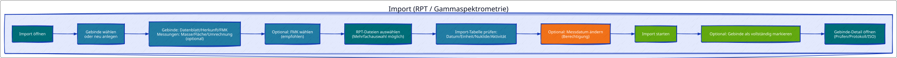
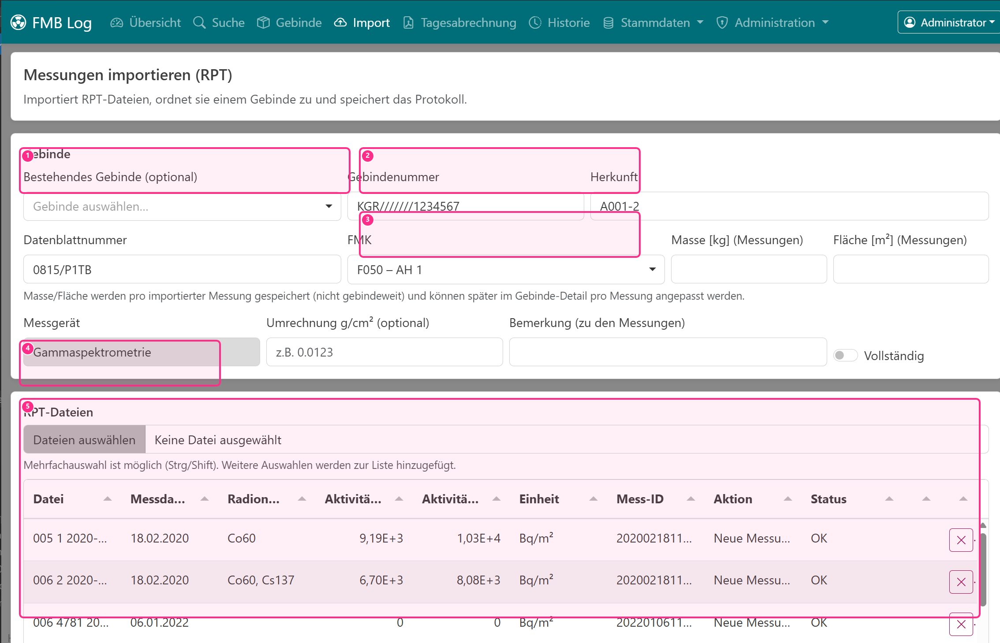

# Import (RPT und MicroCont 2)

Unter **Import** übernehmen Sie RPT-Protokolle der Gammaspektrometrie und CSV-Dateien des MicroCont 2 in die Datenbank. Auch neue Importrevisionen bestehender Messungen werden ausschließlich hier eingelesen. Der Import ist so gestaltet, dass er sowohl für den täglichen Betrieb (schnell mehrere Dateien übernehmen) als auch für Nachweise funktioniert (Originalprotokoll bleibt archiviert).

## Was passiert beim Import?

Beim Import liest FMB Log die RPT-Datei ein, extrahiert die für die Auswertung relevanten Inhalte (u. a. Messzeitpunkt, ISO-11929-Werte) und speichert zusätzlich das **Originalprotokoll** im Archiv.

## Ablaufdiagramm

## Schritt-für-Schritt

Wählen Sie ein bestehendes Gebinde oder legen Sie über **Neues Gebinde** eines an. Bei bestehenden Gebinden sehen Sie die gespeicherten Stammdaten einschließlich Herkunft, Datenblatt, FMK, Stoffmassen, Gebindemasse und gegebenenfalls Gebindeoberfläche.

Abgeschlossene Gebinde stehen nicht als Importziel zur Verfügung. Das gilt auch für neue Importrevisionen. Speichern Sie das Gebinde zuerst wieder als **unvollständig**. Über **Weitere Messungen importieren** im Gebinde gelangen Sie zum Import mit vorausgewähltem Ziel. Ungespeicherte Änderungen werden dabei berücksichtigt.

::: warning Hinweis
Beim Import werden Stammdaten eines bestehenden Gebindes **nicht** geändert – Aktualisierungen erfolgen im Menü **Gebinde**. Zum Anlegen eines weiteren Gebindes verwenden Sie **Neues Gebinde**.
:::

Wählen Sie das **Messgerät** (Gammaspektrometrie oder MicroCont 2) und ergänzen Sie die Parameter für die Messungen. **Masse [kg] (Messungen)** und **Fläche [m²] (Messungen)** sind von der Gebindemasse und Gebindeoberfläche getrennt. Die Vorgaben werden beim Einlesen auf die neuen Messungen angewendet. Bei einer neuen Revision gelten die bisherigen Messungsdaten. Das Messgerät kann geändert werden, solange kein Import vorbereitet ist.

Bei der Auswahl eines Gebindes wird die Masse der letzten konfliktfreien Messung mit passendem Gerät und Probenahmeverfahren vorbelegt. Die Fläche startet mit der Vorgabe des gewählten Verfahrens. Neue **MicroCont-2**-Messungen verwenden die aktuelle Gerätefläche aus **Stammdaten → Messgeräte** (anfangs 177 cm²). Die CSV-Fläche bleibt als Originalwert erhalten; Abweichungen werden in Vorschau und Auswerteprotokoll ausgewiesen.

Eine im RPT enthaltene Probenmenge wird als Messungsmasse oder Messungsfläche übernommen, wenn das entsprechende Feld leer ist. Unterstützt werden g, kg, cm² und m². Bereits eingetragene Werte werden nur nach Ihrer Auswahl im gemeinsamen Mengendialog ersetzt. **Abbrechen** behält die bisherigen Werte. Nicht unterstützte Mengen erscheinen als Hinweis in der Vorschau. Gebindestammdaten bleiben davon unberührt.

Die eigene Card **Dateien und Importvorschau** zeigt nach der Auswahl die Dateien mit Messdatum, Mess-ID, Radionukliden, Aktivität (BS), Vergleichswert (OG), Einheit, Aktion und Status. Bei MicroCont 2 werden zusätzlich Messpunkte, Gebindezuordnung und effektiver Wirkungsgrad angezeigt. **Prüfen** öffnet die Messdaten der betreffenden Zeile; **Entfernen** nimmt sie aus dem vorbereiteten Import. Die **Importaktion** bietet neue Messung, Überspringen oder eine bestehende Messung als Revisionsziel an. **Vergleichen** zeigt die bisherigen und vorbereiteten Werte. Änderungen an Datum, Messdaten oder Zuordnungen aktualisieren die Vorschau.

Falls im Protokoll Messwerte in unterschiedlichen Einheiten vorkommen (z. B. massenspezifisch vs. oberflächenspezifisch), kann eine **Umrechnung** über $g/cm^2$ hinterlegt werden. Diese wird genutzt, um Werte zwischen $Bq/g$ und $Bq/cm^2$ umrechnen zu können.

Anschließend wählen Sie die zum Messgerät passenden Dateien aus. Die Dateiauswahl unterstützt **Mehrfachauswahl** – weitere Auswahlen werden **zur Liste hinzugefügt**, nicht ersetzt.

Für jede neue Messung schlägt FMB Log automatisch eine **Mess-ID** vor. Sie können diese vor dem Speichern anpassen. Für eine neue Revision wählen Sie ausdrücklich die bestehende Messung aus.

## Standardwerte und einzelne Messungen

**Standardwerte für neue Messungen** gelten für alle anschließend eingelesenen Dateien. Unter **Einstellungen der ausgewählten Messung** ändern Sie die Werte nur für die dort benannte Messung. Die beiden Bereiche sind deshalb keine doppelte Abfrage.

Wischteste und Kratzproben starten mit **300 cm² (0,03 m²)** als wahrer Messfläche und maximaler Mittelungsfläche. Beide Angaben bleiben änderbar. Beim Wechsel von MC2 zurück zur Gammaspektrometrie wird die passende Vorgabe wiederhergestellt. Die MC2-Gerätefläche beträgt standardmäßig 177 cm². Bestehende Messungen werden nicht pauschal umgestellt; neue Importrevisionen übernehmen ihre bisherigen Einstellungen.

## Neue Messungen und Importrevisionen

Für neue Messungen bleibt **Neue Messungen** ausgewählt. Mehrere Dateien können gemeinsam eingelesen und gespeichert werden; weitere Auswahlen ergänzen die vorbereitete Liste. Die vorgeschlagenen Mess-IDs können Sie vor dem Speichern prüfen und anpassen.

Für einen Re-Import wählen Sie im selben Bereich die bestehende Messung des gewählten Gebindes und anschließend **Neue Importrevision einlesen**. Das neue Protokoll wird als Revision derselben Messung gespeichert. Frühere Revisionen und Originalprotokolle bleiben erhalten. Ein bereits bekanntes Original wird beim Erstimport nicht versehentlich ein zweites Mal angelegt.

Über **Revision ohne neue Datei** übernehmen Sie die bestehende Messung mit unverändertem Originalprotokoll. In der Vorschau können Sie Bemerkungen hinzufügen oder ändern und bei MicroCont 2 die Messzeit sowie die Nulleffektmesszeit anpassen, auch für einzelne Messpunkte. Beim Speichern entsteht eine neue signierte Revision mit eigener Revisionsnummer. Die bisherigen Zeiten und Bemerkungen bleiben in der vorherigen Revision erhalten. Das Originalprotokoll muss dafür verfügbar sein.

Beim Wechsel von Gebinde oder Messung bleiben ungespeicherte Eingaben geschützt: Sie können weiterarbeiten oder den Entwurf ausdrücklich verwerfen.

Nach dem Speichern bleibt das **Importergebnis** sichtbar. Es unterscheidet übersprungene Dateien, lokal gespeicherte Messungen mit ausstehender Serverbestätigung und abgeglichene Messungen. Gleichzeitige lokale Änderungen lösen ein automatisches erneutes Laden aus; bereits eingegebene Werte bleiben erhalten.

Unter **Gebinde** stehen die ISO-11929-Werte beziehungsweise MC2-Messpunkte neben dem Originalprotokoll. Bei MC2 werden die effektive Messeffizienz und der höchste OG-Wert angezeigt; gespeicherte Messungen verwenden ihre gebundene FMK- und Nuklidvektorfassung.

Vollständige RPT-Protokolle mit leerer ISO-Nuklidtabelle oder ausschließlich Nukliden außerhalb des gemeinsamen Stammdatenkatalogs für Nuklidvektoren und Freigabewerte werden als bestätigter Nullbefund importiert. **Keine Nuklide über EKG** bezieht sich dabei auf die ausgewerteten Nuklide. Die vollständigen Originalzeilen bleiben erhalten; Benutzerbemerkungen werden nicht ersetzt. Enthält die Tabelle auch relevante Gamma-Nuklide, werden deren Werte regulär ausgewertet. Ein Nullbefund ersetzt nicht die sonstigen Voraussetzungen für eine Freigabe, insbesondere die Prüfung der Nachweisgrenzen.

## MC2-Messparameter und Gerätevorgaben

Die MC2-Messparameter stehen im Import und in der Messungsansicht in einer eigenen Card. Der Button **MC2-Parameter in neuer Revision bearbeiten** gehört zum Kopf dieses Bereichs; **Gerätevorgaben übernehmen** steht bei den Parametern.

Die Mittelungs-/Bezugsmasse wird mit höchstens vier Nachkommastellen angezeigt. Im aktiven Eingabefeld bleibt der vollständige Wert bearbeitbar. Diese Formatierung rundet weder gespeicherte Werte noch Berechnungen.

**Stammdaten → Messgeräte** ist für alle angemeldeten Nutzer lesbar. Mit **Messgeräte verwalten** (`devices.manage`) oder als Administrator lassen sich die gemeinsamen Vorgaben von MicroCont 2 bearbeiten: Fläche, Geometrie- und Emissionsfaktor mit relativen Standardunsicherheiten, Standardzeiten und Nuklideffizienzen. **Speichern** übernimmt den Entwurf, **Verwerfen** stellt den vorherigen Stand wieder her. Andere Gruppen erhalten dieses Recht nicht automatisch.

**MC2-Messparameter** zeigt Messzeit und Nulleffektmesszeit sowie die beiden Faktoren mit ihren relativen Standardunsicherheiten. Einzelne Punktzeiten stehen im aufklappbaren Detailbereich. Im Importentwurf und in einer neuen Revision können Faktoren und Unsicherheiten mit den vorhandenen Import- beziehungsweise Messungsänderungsrechten angepasst werden. **Individuell** kennzeichnet ausdrücklich gesetzte Werte; **Gerätevorgaben übernehmen** lädt bewusst die aktuellen Vorgaben und setzt Faktoren und Zeiten zurück. Offene Eingaben werden bei Hintergrundaktualisierungen erhalten.

Neue Importe erhalten aktuelle Gerätevorgaben. Neue Revisionen übernehmen aktuelle Vorgaben und bewahren ausdrückliche Faktorabweichungen und tatsächliche Messzeiten. Gerätestand, effektive Parameter und Originalfläche werden mit der Messrevision signiert. Änderungen an Gerätevorgaben verändern keine bestehenden Messrevisionen, Gültigkeitskennzeichen, Protokolle oder Abrechnungen und erzeugen keine automatischen Revisionen. Bewusst gespeicherte Messungsänderungen durchlaufen weiterhin die Prüfung betroffener Abrechnungen.

Die relativen Standardunsicherheiten von Fläche, Geometrie und Emissionswahrscheinlichkeit werden unabhängig quadratisch kombiniert. Das MC2-Auswerteprotokoll nennt die verwendeten Faktoren, Unsicherheiten, Fläche, Nuklideffizienzen und tatsächlichen Punktzeiten. Bereits ausgestellte Abrechnungen behalten ihre damaligen Berechnungsregeln; aktuelle Auswertungen historischer Messungen verwenden die aktuelle Nettoeffektregel.

## Hinweise

- Das Gebinde benötigt eine passende **FMK**. Für die Vorschau werden deren Nuklidvektoren und Faktoren für das jeweilige Messjahr verwendet.
- Die Tabelle der ausgewählten Dateien zeigt u. a. Messdatum, erkannte Gamma-Nuklide sowie Vorschauwerte (BS/OG). Wenn erforderliche Stammdaten fehlen, wird die Vorschau als **nicht berechenbar** gekennzeichnet.
- Das **Messdatum** kann nach **Prüfen** bei den Messdaten korrigiert werden. Dafür ist die Berechtigung `measurements.update_date` nötig. Das Originaldatum aus dem Protokoll bleibt zusätzlich gespeichert.
- Nicht lesbare oder fehlerhafte Dateien werden einzeln aufgeführt. Gültige Dateien bleiben in der Vorschau; Größen- und Auswahlgrenzen gelten weiterhin für die gesamte Auswahl.
- Die Bemerkung im Import-Dialog wird pro importierter Messung gespeichert.
- Bei **Offline-Import** ist das Protokoll zunächst nur auf dem importierenden Rechner verfügbar. Andere Arbeitsplätze können die Messung sehen, das Protokoll jedoch erst öffnen, nachdem der Upload erfolgt ist.

::: info Kurzfassung (Import)
1. Gebinde auswählen/anlegen und Messgerät wählen
2. RPT- oder MC2-CSV-Dateien auswählen und Vorschau prüfen
3. Messdaten prüfen oder gezielt eine bestehende Messung für eine Importrevision auswählen
4. Import starten
:::
